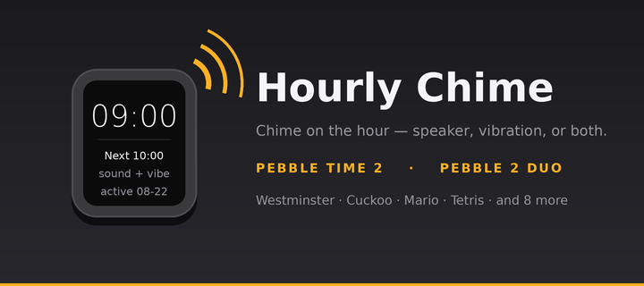
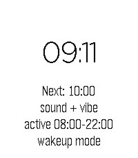
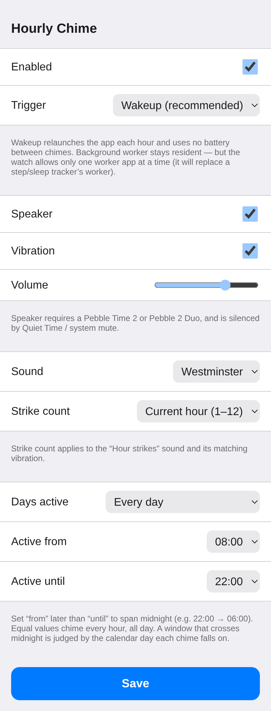
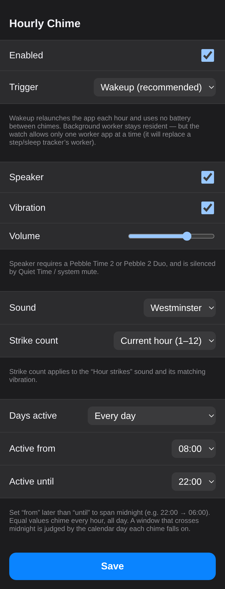

# Hourly Chime



A PebbleOS watchapp that chimes on the hour with the speaker and/or the vibration
motor. Runs on **Pebble Time 2 (`emery`)** and **Pebble 2 Duo (`flint`)** — the
two watches with a speaker.

## Screenshots

<p>
  
  
  
</p>

The watch screen (left) shows the next chime, the sound/vibe mode, the active
window, and the trigger backend. The config page (**Settings → Hourly Chime** in
the Pebble app) follows the phone's light or dark theme.

## How it stays alive

Only the foreground app can drive the speaker and motor, so every trigger ends by
launching the app to chime once and exit. Two backends, chosen on the config page:

- **Wakeup** (default) — schedules one wakeup for the next active top-of-hour. No
  resident process; the screen briefly shows the app each hour. Uses 1 of 8
  wakeup slots.
- **Background worker** — stays resident and watches for the top of the hour. The
  watch allows only one background worker, so this displaces any step/sleep
  tracker.

## Chime styles

Single beep, Westminster (first phrase of the Quarters), Cuckoo, Hour strikes
(a fixed count, or the current 12-hour hour), Mario (opening phrase of the
Super Mario Bros. theme), Star Wars (opening bars of the main title), SpongeBob
("Who lives in a pineapple under the sea?"), X-Files (the theme's whistled chorus),
Batman (the 1960s TV theme riff), Casio beep (the F-91W hourly signal),
Nokia tune (the "Gran Vals" phrase), Tetris (Korobeiniki), 20th Century
Fox (the movie fanfare hook), Mission: Impossible (the 5/4 theme hook), and
Indiana Jones (The Raiders March opening hook).

## Settings

From the Pebble phone app (**Settings → Hourly Chime**): enabled, trigger mode,
speaker/vibration/volume, sound style, which days to chime (every day, weekdays
only, or weekends only), and an active window (`start`–`end` hour, inclusive; set
start > end to span midnight). A window that crosses midnight is judged by the
calendar day each chime falls on.

In-app: **Select** toggles enabled, **long-press Select** plays a test chime.

## Build

```sh
pebble build
pebble install --emulator emery      # or: --phone <ip>
```

The emulator has no speaker, so audio needs a real watch; scheduling, the worker,
and the UI all work in the emulator. Built against the Core Devices SDK `4.33.1`.
The launcher icon comes from `scripts/mkicon.py` (needs Pillow).
